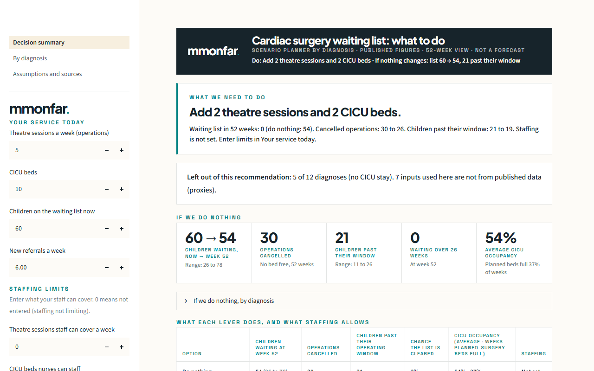

# Cardiac Waiting List Planner

What happens to the cardiac waiting list if we add theatre time, beds or staff? A scenario planner built on published evidence, with the option to use your own figures.

**Status: prototype · not a medical device · shows a range of possible years, not a forecast.**

---

## What you see

The planner works by **diagnosis**. Open the app and the first screen answers four questions without any set-up:

1. **What do we need to do?** The smallest change tested that clears the waiting list (at most one week of new referrals left at week 52, in 9 of 10 simulated years), adds no extra cancelled operations and keeps CICU occupancy at or below your comfortable level, in one sentence. It also lists the diagnoses left out because no published figure exists.
2. **What if we do nothing?** The waiting list, operations cancelled for lack of a bed, and children past their operating window, over 52 weeks, with a likely range. A sticky bar keeps the answer in view while you scroll.
3. **What does each lever do?** Extra theatre sessions, extra CICU beds, or both, side by side.
4. **What does staffing allow?** Enter how many sessions and beds your staff can cover. Any option that needs more is marked.

Two more pages: **By diagnosis** (every value with its status, and a place to enter your own figures) and **Assumptions and sources** (the full table, a source and DOI on every value).

## Published evidence first, your figures if you wish

Every diagnosis figure comes from the published literature, with a DOI. Where none exists the cell shows **enter your figures** and that diagnosis is **left out of the default recommendation**; nothing is invented. Only the size of your service (sessions, beds, waiting list, referrals a week) is entered by you. Urgency is never entered: the planner derives it from each diagnosis's published operating window.



## How to run

Python 3.11 or newer.

```bash
git clone https://github.com/mmonfar/cardiac_model.git
cd cardiac_model
python -m venv .venv
.venv/bin/pip install -e ".[dev]"        # Windows: .venv\Scripts\pip install -e ".[dev]"
.venv/bin/streamlit run src/cardiac_capacity_planner/app.py
.venv/bin/pytest                          # optional: the test suite
```

Run the tests from the repository root without installing with `PYTHONPATH=src python -m pytest`. If another environment already has a `cardiac_capacity` package installed, `PYTHONPATH=src` is required: without it that older package shadows this repository and some test modules fail to import.

Everything installs from PyPI (numpy, pandas, plotly, streamlit). The theme and its two fonts are bundled, so the app needs no other folder or external service.

## How it works, in brief

- Each week: children on the list age, those past their operating window may get worse (one random draw per child), new referrals arrive by each diagnosis's share of operations, and operations are scheduled least slack first. Each stay holds a bed for a random length.
- Getting worse while waiting: no published figure states a waiting time, so the planner counts children past their operating window and adds no deterioration unless you enter a weekly chance for a diagnosis. The one delay odds ratio found (transposition with VSD, repair after day 8, aOR 1.49) is about complications after surgery and states no waiting time, so it is not used. If a source states the waiting time, the planner can convert its odds ratio (Zhang and Yu, JAMA 1998) to a weekly hazard, with the 95% interval as a band.
- This is repeated for 60 simulated years, so the page shows a typical year and a range. Every result is reproducible from its seed.
- Staffing is a limit you enter, not a lever with its own model.

## Where the figures come from

**72 cells (12 diagnoses x 6 parameters): 18 published for exactly this (F), 23 from a nearby published figure (P), 31 with no published figure (G).** The same table is in the app under "Assumptions and sources". Shares are shares of operations in a national audit, not shares of referrals. Stays are published medians used as average stays. Not clinically checked.

| Diagnosis | Operating window (weeks) | Weekly deterioration once past the window | Waiting-list outcome | CICU stay (days) | Ward stay (days) | Share of operations |
|---|---|---|---|---|---|---|
| Tetralogy of Fallot | **F** Elective repair at 3 to 6 months if symptoms are none or mild; at once if severe. The window ends at 26 weeks. (Martins et al. 2018, doi:10.21470/1678-9741-2018-0019) | **G** No published odds or risk ratio for late versus timely repair in the sources reviewed. Enter your figure. | **P** Untreated survival 66% at 1 year, 49% at 3 years. Upper bound for a child with no treatment. (Saxena et al. 2019, doi:10.4103/apc.apc_32_19) | **F** Median 4 days (IQR 2 to 10), repair, one US centre (J Am Heart Assoc 2026, doi:10.1161/jaha.125.048547 (one US centre, 2018-2023, Table 2)) | **F** Median 4 days (IQR 3 to 7), acute care unit (J Am Heart Assoc 2026, doi:10.1161/jaha.125.048547 (one US centre, 2018-2023, Table 2)) | **P** 2,359 of 36,641 operations (6.4%). Share of operations, not of referrals. (UK national audit 2000-2010, Open Heart 2015, doi:10.1136/openhrt-2014-000157 (Table 2, 36,641 operations)) |
| Transposition (TGA), intact septum | **F** Arterial switch within 3 to 4 weeks of life, before the left ventricle regresses (Saxena et al. 2019, doi:10.4103/apc.apc_32_19) | **G** No published odds or risk ratio for late versus timely repair in the sources reviewed. Enter your figure. | **P** About 90% die in year 1 untreated. Upper bound for a child with no treatment. (Saxena et al. 2019, doi:10.4103/apc.apc_32_19) | **F** Median 7 days (IQR 5 to 11), England and Wales, n=1,772 (Dorobantu et al. 2023, doi:10.1016/j.jacadv.2023.100407) | **P** Median 9 days (IQR 6 to 12), acute care unit; switch with or without VSD closure (J Am Heart Assoc 2026, doi:10.1161/jaha.125.048547 (one US centre, 2018-2023, Table 2)) | **P** 1,393 of 36,641 operations (3.8%). Share of operations, not of referrals. (UK national audit 2000-2010, Open Heart 2015, doi:10.1136/openhrt-2014-000157 (Table 2, 36,641 operations)) |
| Transposition with VSD | **F** Repair mostly in week 1 (median age 6 days); complications rise after day 8 (Faateh et al. 2025, doi:10.1016/j.xjon.2024.10.015) | **G** Published: odds ratio 1.49 (95% CI 1.02 to 2.15) for complications after surgery when repair is after day 8 (Faateh et al. 2025, doi:10.1016/j.xjon.2024.10.015). The source states no waiting time, so it gives no weekly chance. Not used. Enter your figure. | **P** Expert estimate: about 1 year untreated (selection-biased). (Cardarelli et al. 2018, doi:10.1001/jamanetworkopen.2018.4707) | **F** Median 8 days (IQR 5 to 14) in ICU after the operation, US PHIS, n=1,005 (Faateh et al. 2025, doi:10.1016/j.xjon.2024.10.015) | **P** Median 9 days (IQR 6 to 12), acute care unit; switch with or without VSD closure (J Am Heart Assoc 2026, doi:10.1161/jaha.125.048547 (one US centre, 2018-2023, Table 2)) | **P** 428 of 36,641 operations (1.2%). Share of operations, not of referrals. (UK national audit 2000-2010, Open Heart 2015, doi:10.1136/openhrt-2014-000157 (Table 2, 36,641 operations)) |
| Ventricular septal defect (VSD) | **G** The guideline list of closure times did not survive conversion. Enter your window. | **G** No published odds or risk ratio for late versus timely repair in the sources reviewed. Enter your figure. | **F** 60% of 132 children with isolated VSD closed on their own by 6 years. Used as a weekly exit from the list. (Li et al. 2019, doi:10.1002/clc.23173) | **F** Median 3 days (IQR 1 to 10), repair, one US centre (J Am Heart Assoc 2026, doi:10.1161/jaha.125.048547 (one US centre, 2018-2023, Table 2)) | **F** Median 4 days (IQR 3 to 7), acute care unit (J Am Heart Assoc 2026, doi:10.1161/jaha.125.048547 (one US centre, 2018-2023, Table 2)) | **P** 3,583 of 36,641 operations (9.8%). Share of operations, not of referrals. (UK national audit 2000-2010, Open Heart 2015, doi:10.1136/openhrt-2014-000157 (Table 2, 36,641 operations)) |
| Complete AVSD | **P** No stated window. Irreversible lung vessel disease can start by 6 months in Down syndrome. (Saxena et al. 2019, doi:10.4103/apc.apc_32_19) | **G** No published odds or risk ratio for late versus timely repair in the sources reviewed. Enter your figure. | **P** 54% alive at 6 months, 35% at 12 months untreated. Upper bound. (Saxena et al. 2019, doi:10.4103/apc.apc_32_19) | **G** No CICU figure for this diagnosis. | **G** Only total hospital stay is published (Al-Wassia 2022, doi:10.1186/s43044-022-00292-8). It includes the CICU. | **P** 1,357 of 36,641 operations (3.7%). Share of operations, not of referrals. (UK national audit 2000-2010, Open Heart 2015, doi:10.1136/openhrt-2014-000157 (Table 2, 36,641 operations)) |
| Hypoplastic left heart (HLHS), first operation | **F** Fatal untreated, usually within the first week; first operation in the newborn period (Gobergs et al. 2016, doi:10.6001/actamedica.v23i2.3325) | **G** No published odds or risk ratio for late versus timely repair in the sources reviewed. Enter your figure. | **F** Loss between first and second operation 8% (2.5% with home monitoring, 10.3% without) (Staehler et al. 2023, doi:10.3389/fcvm.2023.1239477) | **F** Mean 19.6 days (SD 20.6), 3 studies, 183 children (Iskander et al. 2024, doi:10.3390/jcm13144244) | **F** Median 14 days (IQR 6 to 24), acute care unit, first operation (J Am Heart Assoc 2026, doi:10.1161/jaha.125.048547 (one US centre, 2018-2023, Table 2)) | **P** 931 of 36,641 operations (2.5%). Share of operations, not of referrals. (UK national audit 2000-2010, Open Heart 2015, doi:10.1136/openhrt-2014-000157 (Table 2, 36,641 operations)) |
| Coarctation of the aorta | **G** No stated window. Critical coarctation is a newborn problem (median age 11 days). | **G** No published odds or risk ratio for late versus timely repair in the sources reviewed. Enter your figure. | **G** Not in the published sources we hold. Enter your figure. | **G** The only CICU figure is for a catheter bridge, not for surgery. | **G** Not in the published sources we hold. Enter your figure. | **P** 2,243 of 36,641 operations (6.1%). Share of operations, not of referrals. (UK national audit 2000-2010, Open Heart 2015, doi:10.1136/openhrt-2014-000157 (Table 2, 36,641 operations)) |
| Patent ductus arteriosus (PDA) | **G** No upper window. Many close on their own. | **G** No published odds or risk ratio for late versus timely repair in the sources reviewed. Enter your figure. | **P** Preterm closure on its own: 34% by day 4 below 28 weeks (improvement, not deterioration). (de Klerk et al. 2020, doi:10.3389/fped.2020.00541) | **G** Not in the published sources we hold. Enter your figure. | **G** Not in the published sources we hold. Enter your figure. | **P** 3,012 of 36,641 operations (8.2%). Share of operations, not of referrals. (UK national audit 2000-2010, Open Heart 2015, doi:10.1136/openhrt-2014-000157 (Table 2, 36,641 operations)) |
| Atrial septal defect (ASD) | **G** The guideline list of closure ages did not survive conversion. Enter your window. | **G** No published odds or risk ratio for late versus timely repair in the sources reviewed. Enter your figure. | **G** Not in the published sources we hold. Enter your figure. | **F** Median 1 day (IQR 1 to 1), repair, one US centre (J Am Heart Assoc 2026, doi:10.1161/jaha.125.048547 (one US centre, 2018-2023, Table 2)) | **F** Median 2 days (IQR 2 to 3), acute care unit (J Am Heart Assoc 2026, doi:10.1161/jaha.125.048547 (one US centre, 2018-2023, Table 2)) | **P** 2,053 of 36,641 operations (5.6%). Share of operations, not of referrals. (UK national audit 2000-2010, Open Heart 2015, doi:10.1136/openhrt-2014-000157 (Table 2, 36,641 operations)) |
| Obstructed TAPVC | **F** Obstruction means no safe wait: 18% needed emergency surgery (Ji et al. 2021, doi:10.3389/fcvm.2021.775578) | **G** No published odds or risk ratio for late versus timely repair in the sources reviewed. Enter your figure. | **P** Obstruction in 26% of children; early deaths 8.7% (after surgery). (Ji et al. 2021, doi:10.3389/fcvm.2021.775578) | **F** Median 3 days (IQR 2 to 4), one centre, newborns (Ji et al. 2021, doi:10.3389/fcvm.2021.775578) | **G** Not in the published sources we hold. Enter your figure. | **P** 644 of 36,641 operations (1.8%). Share of operations, not of referrals. (UK national audit 2000-2010, Open Heart 2015, doi:10.1136/openhrt-2014-000157 (Table 2, 36,641 operations)) |
| Truncus, interrupted arch, pulmonary atresia with VSD | **G** Not in the published sources we hold. Enter your figure. | **G** No published odds or risk ratio for late versus timely repair in the sources reviewed. Enter your figure. | **P** Expert estimate untreated: truncus 1 year, interrupted arch 1 year (selection-biased). (Cardarelli et al. 2018, doi:10.1001/jamanetworkopen.2018.4707) | **G** Not in the published sources we hold. Enter your figure. | **G** Not in the published sources we hold. Enter your figure. | **P** 832 of 36,641 operations (2.3%). Share of operations, not of referrals. (UK national audit 2000-2010, Open Heart 2015, doi:10.1136/openhrt-2014-000157 (Table 2, 36,641 operations)) |
| Other / not listed | **G** Enter a window, or the group has no deadline and is scheduled last. | **G** No published odds or risk ratio for late versus timely repair in the sources reviewed. Enter your figure. | **P** Norway: of 2,359 infants with severe heart disease, 10% died, 58% of those before surgery. (Wik et al. 2020, doi:10.1136/archdischild-2019-317581) | **G** Not in the published sources we hold. Enter your figure. | **G** Not in the published sources we hold. Enter your figure. | **P** All other operations in the same audit (17,806 of 36,641). Share of operations, not of referrals. (UK national audit 2000-2010, Open Heart 2015, doi:10.1136/openhrt-2014-000157 (Table 2, 36,641 operations)) |

Service-size defaults:

| Parameter | Default | Basis | Source | What the model assumes because data is missing |
|---|---|---|---|---|
| Waiting list, referrals a week, theatre sessions, CICU beds | 60, 5, 5, 10 | assumption | an illustrative unit, not a literature figure | These describe a service, not a disease. Enter your own. |
| Safe CICU occupancy target | 85% | assumption | no published level was found | Many units quote a figure around this level, but it is your call. |
| Staff who can cover theatre sessions and CICU beds | not set | assumption | no published figure; it depends on your rosters | Staffing is not limiting until you enter a cap. Enter yours to see which options are out of reach. |

The untreated survival figures in the table are upper bounds for a child with no treatment. The planner does not use them as waiting risk. Earlier derivations: [`docs/risk-table.md`](docs/risk-table.md), [`docs/hazard-calibration-output.md`](docs/hazard-calibration-output.md). What changed from v2.1: [`docs/v2.1-vs-v2.2.md`](docs/v2.1-vs-v2.2.md).

## Limitations

- Prototype. Not validated against real data. No forecast. The table has not been checked by a clinician.
- 31 of 72 cells have no published figure. Five of 12 diagnoses are left out of the default recommendation, so the default answer understates demand. Enter your figures to include them.
- The defaults contain no weekly deterioration while waiting. It appears only when you enter it for a diagnosis.
- No deaths are modelled while waiting.
- Staffing is a limit you enter. Not modelled: a catheter-lab queue, bridge procedures, weight- and age-dependent stays, a ward-bed model (ward stays are shown, not yet simulated).
- The v2.1 ward and CICU detail pages are no longer in the app (they used urgency categories). Their engines stay in the package and are tested.

## Project layout

```
src/cardiac_capacity/          engines: ward (v1, v2), CICU (v1, v2, stochastic plan), recommenders, parameter sets, case mix
src/cardiac_capacity_planner/  Streamlit app (pages: Decision summary, By diagnosis, Assumptions and sources) and the bundled theme and fonts
tests/                         engine and app tests (synthetic data only)
analysis/                      scripts that regenerate the figures in docs/
docs/                          parameter tables, sanity check, screenshots, earlier results
```

## Licence

Code is licensed under **AGPL-3.0-or-later** (see [`LICENSE`](LICENSE)); a commercial licence is available on request from the author via [LinkedIn](https://www.linkedin.com/in/martin-monteagudo-farina/). Non-code content is under [CC BY-NC 4.0](https://creativecommons.org/licenses/by-nc/4.0/). Details in [`LICENSING.md`](LICENSING.md). The two bundled fonts keep their own SIL Open Font License 1.1 (`src/cardiac_capacity_planner/brand/fonts/OFL.txt`).

## Disclaimer

Research and demonstration software. Not a medical device and not intended for clinical decision-making, diagnosis or treatment. Provided "as is", without warranty of any kind; the author accepts no liability for any use. Uses synthetic data only.

Built with AI assistance (Claude); all code and claims reviewed by the author. See [`LICENSE`](LICENSE) for the full warranty terms.

## Independence and data notice

**Independence and data notice.** This is a personal project, developed independently in my own time and on my own equipment. It is not affiliated with, endorsed by, or representative of my employer or any other organisation. It contains no employer data, systems, code or confidential information. All data in this repository is synthetic or fictitious, and any resemblance to real patients, staff or events is coincidental. Views are my own.
